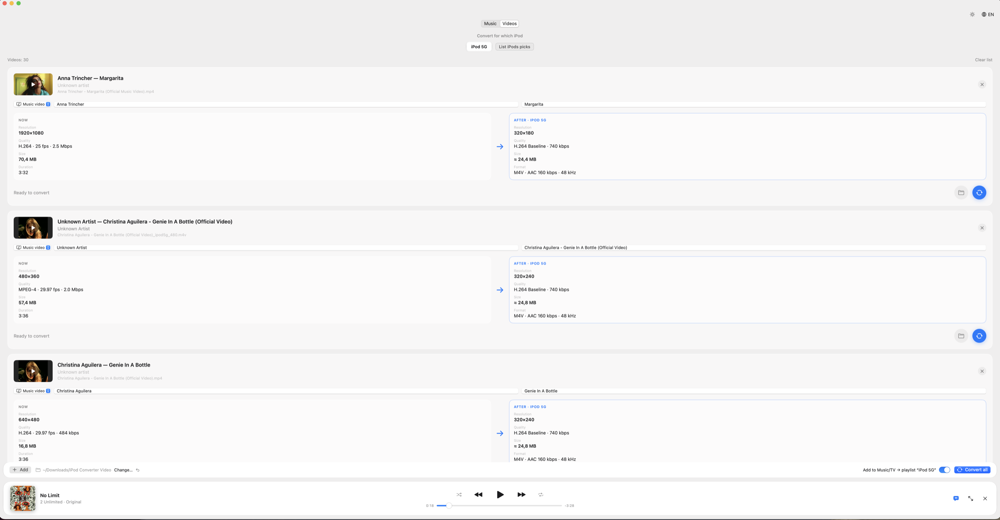

# iPod Converter

An app for **macOS, Windows and Linux** that turns any video or music file into something your iPod actually plays —
iPod 5G/5.5G, iPod classic, iPod nano and iPod touch. Drop files in, pick your iPod, press Convert.
Everything is done locally with FFmpeg. The Mac app is the full version (iTunes/Music sync, tag lookup, player);
the [Windows](#windows) and [Linux](#linux) versions convert with the same presets and engine.




## Download

Get the latest DMG from **[Releases](https://github.com/JulianIvanov125/Ipod-Converter/releases/latest)**,
open it and drag **iPod Converter** to Applications.

- Requires a Mac with Apple Silicon and macOS 14 or later. Nothing else to install — FFmpeg is built in.
- The app is not notarized by Apple. On first launch macOS will block it: open
  **System Settings → Privacy & Security** and click **Open Anyway**.
- Updates are built in: **iPod Converter → Check for Updates… → Update and Restart** (the download is checked
  against the release's SHA-256 before it is installed).

Windows and Linux downloads are on the same [Releases](https://github.com/JulianIvanov125/Ipod-Converter/releases/latest)
page — see [Windows](#windows) and [Linux](#linux).

## Features

**Video**
- A preset for every video iPod: resolution, H.264 profile/level and bitrate within the device limits;
  Standard or **Maximum** quality — 640×480 on 5.5G, iPod classic and nano 3–5, 720×480 (H.264 Main) on iPod nano 7 —
  picked right in the output settings
- Video bitrate never goes above 1.3 × the source (at least 500 kbps), so low-bitrate clips don't grow
- Audio is encoded with Apple's AAC encoder and a limiter, so loud tracks don't clip into crackle on the iPod
- Reads MKV, AVI, WMV, WebM, MPG/VOB, TS, MOV, MP4 and more, including AV1 (4K YouTube downloads);
  deinterlaces DVD/TV recordings
- Sorts files into music videos, films and TV series with proper iTunes tags; series are grouped by
  show and season — episode names are parsed in English, Russian, Ukrainian and Belarusian
  (`S01E02`, `1x02`, `Season 1 Episode 2`, `Сезон 1 Серия 2`, `1 сезон 2 серія` …), anime-style numbering
  (`Show - 05`, `Show_[252]_[1080p]`) and double episodes (`Show - 101-102`)
- Checkboxes, type filter, change the type of many videos at once
- Custom output settings on top of the preset: MP4/MOV, HEVC, up to 1080p, video and audio bitrate
- Output files are named with the target, e.g. `Lost S01E01 [iPod 5.5G].m4v`; leftovers of older conversions
  (`_ipod5g_480`, "Unknown Artist" tags) are cleaned up
- Big batches run as a queue (two videos at a time) with an overall progress bar
- Approximate time next to Convert — "≈ 3 min" before you start, "≈ 2 min left" while it runs (music too);
  it learns how fast your Mac converts
- Before → after: converted files are read back and show their real resolution, bitrate, audio and size
- Duplicates filter for videos: the same music video, film or episode added twice (ignoring tails like `_ipod5g_480`,
  `[iPod nano 7]` or `(Official Video)`) — the best copy stays, extras go to the Trash; versions made for different
  iPods are not duplicates

**Music**
- Output format: Auto, AAC, MP3 or Apple Lossless — globally or per track; files the iPod already plays are copied
  without re-encoding. The Type column shows the current format → the result for the selected iPod
- FLAC, ALAC, WAV/AIFF (24-bit, hi-res), APE, WavPack, DSD, Opus, Ogg Vorbis, WMA, MP3, AAC
- Missing tags and covers are filled from the Apple Music catalog and written straight into the original file —
  no re-encoding, the file is replaced only after a check (same audio, nothing lost, iTunes gapless data kept);
  existing tags are never overwritten
- Tag editor: double-click a track to edit title, artist, album, year, genre, track/disc and the cover
  (drag & drop, file or paste); edit a whole album at once by checking its tracks
- Duplicates filter: same artist and title, the best copy stays; extra copies go to the Trash one by one or all at once
- Tracks that are already in your Music library are never copied or added again
- Star ratings read from files and synced with the Music app
- Column sorting and search that ignores Latin/Cyrillic and wrong keyboard layout (`kino` = `Кино` = `rbyj`)

**Player**
- Preview originals and converted files; mini player for video, Apple Music–style bar for tracks
- MKV, AVI and other files macOS can't open itself start playing in about a second, even 8 GB films —
  they are streamed while being prepared, and you can jump anywhere
- Full screen with synced lyrics (.lrc, file tags or LRCLIB) and visualizers that follow the song's dynamics:
  a 20 Hz – 20 kHz equalizer, a water-ripple simulation tinted by the cover, and flowing cover colors
- Volume, repeat, shuffle; shows up in macOS Now Playing and reacts to media keys

**Your iPods**
- Connected iPods are detected automatically and shown under their own names (e.g. "Alex's iPod nano"),
  with capacity and free space; the bottom bar tells you whether the converted files will fit
- iPod 5G and 5.5G report the same ID; the app tells them apart by the serial number macOS keeps for iPods
  it has seen (also for modded iPods with an empty SysInfo). If it can't, pick the right one with the ⌄ button
  on the iPod tab
- Every iPod tab keeps its own state — what was converted, what failed — so converting for one iPod
  doesn't mark files as done for another

**iPod sync**
- Videos go straight to the Music / TV app into a playlist per iPod model, so each iPod syncs only its own
  playlist in Finder; music videos get the iPod model as album, so the Music app keeps a separate copy per iPod
- Tracks go to your Music library; optionally into a playlist of your own, and a cover maker creates
  Apple Music–style placeholder covers for it
- Tags and covers written into files are updated in the Music app too (right away, or when Music is opened next);
  "Covers → Music" fixes albums that Music shows grey although the tracks have covers
- If something fails, "Copy for support" gives a report with what succeeded, where it failed and the error text

**Look** — Clear Glass design, light/dark theme, English / Russian / Ukrainian / Belarusian.

## Use with Claude (MCP)

iPod Converter includes an [MCP](https://modelcontextprotocol.io) server, so Claude can use it for you: “what fits on my nano?”, “convert this album for my iPod 5G and put it in a playlist”, “find duplicate tracks in ~/Music/CD”.

Claude Code:

```bash
claude mcp add ipod-converter -- "/Applications/iPod Converter.app/Contents/MacOS/iPodConverter" --mcp
```

Claude Desktop — add to `~/Library/Application Support/Claude/claude_desktop_config.json`:

```json
{
  "mcpServers": {
    "ipod-converter": {
      "command": "/Applications/iPod Converter.app/Contents/MacOS/iPodConverter",
      "args": ["--mcp"]
    }
  }
}
```

| Tool | What it does | Changes files |
|---|---|---|
| `list_ipods` | Connected iPods: model, name, capacity, free space | No |
| `inspect_files` | Current format → result for the iPod, estimated size, whether it fits | No |
| `find_duplicates` | Duplicate tracks: which copy to keep, which are extra | No |
| `convert` | Converts for the iPod (`max_quality` for the Maximum preset) and adds to Music/TV (optionally into a playlist) | Creates new files |
| `fill_tags` | Fills missing tags and covers from Apple Music into the original files (no re-encoding) | Yes |
| `repair_music_covers` | Sets each track's cover in Music again from its file (fixes grey albums) | Music rewrites the artwork |
| `trash_duplicates` | Moves extra copies to the Trash (the kept copy is never touched) | Yes |

The server runs without a window and uses the output folder chosen in the app, so open the app once first. Your app settings are not changed.

## Windows

Windows 10 (version 2004 or later) or Windows 11, on a regular PC (x64) or an ARM laptop (ARM64).

1. Download `iPod-Converter-<version>-Windows-x64-Setup.exe` (most PCs) or `-Windows-arm64-Setup.exe` (Snapdragon / ARM)
   from [Releases](https://github.com/JulianIvanov125/Ipod-Converter/releases/latest) and run it — for all users or just
   for you; Start menu shortcut, uninstall from Settings → Apps. FFmpeg is included.
2. The app is not signed: if SmartScreen warns, click **More info → Run anyway**.
3. Installed with the Setup, the app checks for updates by itself (and from **Output → Check for Updates…**) and
   installs a new version in one click, checking its SHA-256 first.

Prefer no installer? Take `iPod-Converter-<version>-Windows-<arch>.zip`, unzip it anywhere and run
**iPod Converter.exe** (a zip copy only tells you about new versions).

The window (WinUI 3) has the same presets as the Mac app: add files or folders or drag them in, choose the iPod and
Standard / Maximum, pick the output folder and press Convert. The list shows covers, progress and before → after;
the Duplicates tab keeps the best copy and moves extras to the Recycle Bin. The language follows Windows
(English, Russian, Ukrainian, Belarusian).

There is no iTunes sync on Windows yet: add the converted files from the output folder to iTunes and sync the iPod
there. The log is in `%LOCALAPPDATA%\iPod Converter\Logs`.

The conversion engine also works from the command line (`engine\iPodConverter.exe`):

```bat
iPodConverter.exe convert --ipod nano7 --max --out D:\iPod "D:\Videos"
iPodConverter.exe dups "D:\Videos"           & rem add --trash to move extra copies to the Recycle Bin
iPodConverter.exe models
```

## Linux

GTK4 / libadwaita window and command line, packages for x86_64 and arm64 (`.deb` and `.tar.gz`). Linux has no
iTunes / Music app, so the converted files are copied to the iPod with Rhythmbox, Strawberry or gtkpod.
Install, usage and copying to the iPod: **[docs/LINUX.md](docs/LINUX.md)**.

## Feedback and logs

**Help → Report a Problem…** opens a short form (bug, idea or question). You see everything that will be sent —
app version, macOS, iPod models, the last error report and recent log lines, with your home folder replaced by `~` —
and choose how to send it: a prefilled GitHub issue or an email with the log attached. Nothing is sent automatically.
The log lives in `~/Library/Logs/iPod Converter/` (**Help → Show Log in Finder**).

## Build from source

**Mac** — needs Xcode Command Line Tools and Homebrew.

```bash
brew install x264 lame mpg123   # static libraries for the bundled FFmpeg
brew install meson ninja nasm   # to build dav1d (AV1 decoder) from source
./build_ffmpeg.sh               # builds vendor/ffmpeg/{ffmpeg,ffprobe}
./build.sh                      # builds build/iPod Converter.app
./make_dmg.sh                   # optional: packs the app into a DMG
```

**Windows** — needs Swift for Windows, Visual Studio Build Tools (C++ for ARM64/x64 and the Windows SDK), .NET SDK 9
and an FFmpeg build for the target architecture:

```powershell
powershell -ExecutionPolicy Bypass -File build_windows.ps1 -Arch x64 -FFmpegDir C:\Tools\ffmpeg\bin
```

The result is `build-windows\<arch>\iPod Converter\` and a zip next to it; add `-Installer` for the Setup.exe
([Inno Setup 6](https://jrsoftware.org/isinfo.php)). On an ARM64 PC the x64 version is cross-compiled.

**Linux** — see [docs/LINUX.md](docs/LINUX.md) (`./build_linux.sh`).

## License

GPL-3.0 — see [LICENSE](LICENSE). The Mac app bundles FFmpeg built with x264, LAME, mpg123 and dav1d, the Windows
version a GPL build of FFmpeg by [BtbN](https://github.com/BtbN/FFmpeg-Builds); see
[THIRD_PARTY_NOTICES.md](THIRD_PARTY_NOTICES.md).

iPod, Apple Music and iTunes are trademarks of Apple Inc. This project is not affiliated with Apple.
