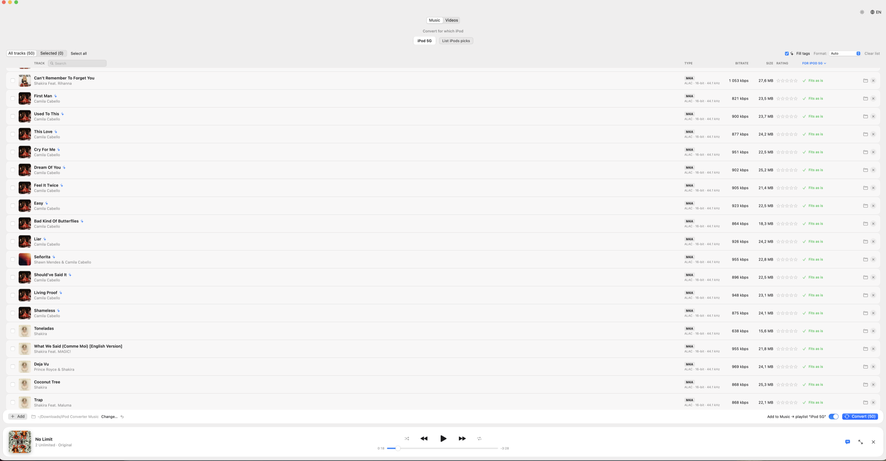

# iPod Converter

A macOS app that turns any video or music file into something your iPod actually plays —
iPod 5G/5.5G, iPod classic, iPod nano and iPod touch. Drop files in, pick your iPod, press Convert.
Everything is done locally with a bundled FFmpeg.




## Download

Get the latest DMG from **[Releases](https://github.com/JulianIvanov125/Ipod-Converter/releases/latest)**,
open it and drag **iPod Converter** to Applications.

- Requires a Mac with Apple Silicon and macOS 14 or later. Nothing else to install — FFmpeg is built in.
- The app is not notarized by Apple. On first launch macOS will block it: open
  **System Settings → Privacy & Security** and click **Open Anyway**.

## Features

**Video**
- A preset for every video iPod: resolution, H.264 profile/level and bitrate within the device limits;
  a "Maximum" 640×480 mode for 5.5G and iPod classic
- Reads MKV, AVI, WMV, WebM, MPG/VOB, TS, MOV, MP4 and more; deinterlaces DVD/TV recordings
- Sorts files into music videos, films and TV series with proper iTunes tags; series are grouped by
  show and season — episode names are parsed in English, Russian, Ukrainian and Belarusian
  (`S01E02`, `1x02`, `Season 1 Episode 2`, `Сезон 1 Серия 2`, `1 сезон 2 серія` …)
- Checkboxes, type filter, change the type of many videos at once
- Custom output settings on top of the preset: MP4/MOV, HEVC, up to 1080p, video and audio bitrate
- Output files are named with the target, e.g. `Lost S01E01 [iPod 5.5G].m4v`

**Music**
- Output format: Auto, AAC, MP3 or Apple Lossless; files the iPod already plays are copied without re-encoding
- FLAC, ALAC, WAV/AIFF (24-bit, hi-res), APE, WavPack, DSD, Opus, Ogg Vorbis, WMA, MP3, AAC
- Missing tags and covers are filled from the Apple Music catalog; existing tags are never overwritten
- Star ratings read from files and synced with the Music app
- Column sorting and search that ignores Latin/Cyrillic and wrong keyboard layout (`kino` = `Кино` = `rbyj`)

**Player**
- Preview originals and converted files; mini player for video, Apple Music–style bar for tracks
- Full screen with synced lyrics (.lrc, file tags or LRCLIB) and visualizers: equalizer, water drops, cover colors
- Repeat, shuffle

**iPod sync**
- Converted files can go straight to the Music / TV app into a playlist per iPod model, so each iPod
  syncs only its own playlist in Finder

**Look** — Clear Glass design, light/dark theme, English / Russian / Ukrainian / Belarusian.

## Build from source

Needs Xcode Command Line Tools and Homebrew.

```bash
brew install x264 lame mpg123   # static libraries for the bundled FFmpeg
./build_ffmpeg.sh               # builds vendor/ffmpeg/{ffmpeg,ffprobe}
./build.sh                      # builds build/iPod Converter.app
./make_dmg.sh                   # optional: packs the app into a DMG
```

## License

GPL-3.0 — see [LICENSE](LICENSE). The app bundles FFmpeg built with x264 and LAME; see
[THIRD_PARTY_NOTICES.md](THIRD_PARTY_NOTICES.md).

iPod, Apple Music and iTunes are trademarks of Apple Inc. This project is not affiliated with Apple.
